# ByteForge

**A handwritten x86-64 assembler, native Linux ELF64 generator, and educational assembly explorer.**

ByteForge translates a small assembly language directly into machine-code bytes
and packages them as a fixed-address Linux executable. TraceLab adds browser
and terminal interfaces for inspecting those same instructions through a
bounded Python simulation.


Its implementation uses Python's standard library, HTML, CSS, and vanilla
JavaScript. No external assembler, linker, frontend build step, or runtime
package installation is required.

- Handwritten encoding for MOV, ADD, SUB, XOR, CMP, JMP, JE, JNE, and SYSCALL.
- Two-pass layout with case-sensitive labels, forward references, and DB data.
- Deterministic, sectionless Linux x86-64 ELF64 executables.
- Source-located errors with filename, line, column, original text, and caret.
- Shared TraceSession engine with reversible history and modeled write/exit.
- Local browser Playground with CPU state, actual bytes, symbols, DB memory,
  captured output, and an execution timeline.

## Application Preview

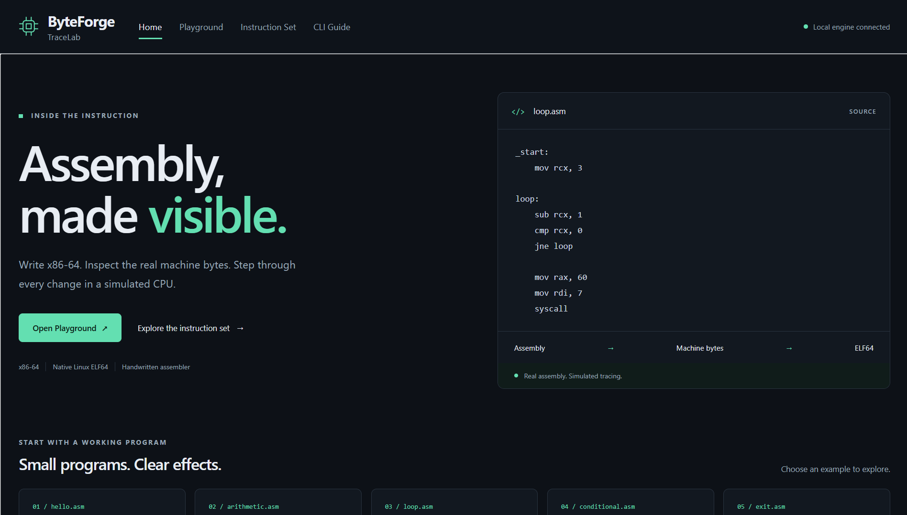

*Figure 1. TraceLab Home, with the Open Playground action, source preview and example selector below.*

[Quick Start](#local-quick-start) · [Instruction forms](#supported-assembly-language) ·
[Troubleshooting](#troubleshooting) · [Contributing](#contributing-and-reporting-issues)

<details>
<summary>Contents</summary>

- [Local Quick Start](#local-quick-start)
- [Requirements and WSL execution](#requirements)
- [Example programs](#example-programs)
- [Architecture](#architecture)
- [Handwritten encoding](#handwritten-x86-64-encoding)
- [ELF64 layout and addresses](#elf64-layout-and-addresses)
- [Supported assembly language](#supported-assembly-language)
- [Browser and terminal tracing](#browser-and-terminal-tracing)
- [Local API and security](#local-api-and-security)
- [Testing and validation](#testing-and-validation)
- [Troubleshooting](#troubleshooting)
- [Repository layout](#repository-layout)
- [Release, deployment and screenshots](#release-deployment-and-screenshots)
- [Contributing and reporting issues](#contributing-and-reporting-issues)
- [References and attribution](#references-and-attribution)
- [License](#license)

</details>

## Local Quick Start

### Obtain a checkout

The verified repository is [AyanChangdar/ByteForge](https://github.com/AyanChangdar/ByteForge).
It is currently private; cloning requires authorized GitHub access. The older
configured origin under `AP24110010120` resolves to this repository.

```bash
git clone https://github.com/AyanChangdar/ByteForge.git
cd ByteForge
```

An existing checkout or authorized source archive can also be used. Run the
commands below from the directory containing `README.md`, `byteforge/`,
`examples/` and `visualizer/`.

> [!NOTE]
> Python 3.10 or newer is required. No `pip install`, Node.js, npm, or frontend
> build is needed. Commands below use `python`; use `python3` on Linux/WSL or
> `py -3` on Windows if that is your Python 3.10+ command.

### Open the browser Playground

```bash
python --version
python -m byteforge.trace_server --port 8765
```

Open **http://127.0.0.1:8765**. Use this exact loopback address: the server
validates the Host header and does not accept `localhost` as an alias.

1. Open **Playground** and select `loop.asm`.
2. Click **Assemble**, then **Step** to see RCX become `0x0000000000000003`.
3. Click **Play** to reach simulated exit status 7.
4. Load and assemble `hello.asm`, then Play and open **Output Console** to see
   `Hello, World!` followed by a newline, with simulated exit status 0.

Keep the terminal running while using the website. Stop the server with Ctrl+C.

### Open the terminal debugger

```bash
python -m byteforge.trace_cli examples/loop.asm --interactive
```

Enter `next`, `registers`, `continue`, `back`, `reset`, or `help`.
Use `quit` to leave the debugger.

### Generate a native executable

```bash
python -m byteforge.cli examples/hello.asm -o build/hello
```

The assembler creates missing output directories and refuses to overwrite
existing files. If `build/hello` already exists, choose another output name.

Run this bundled example only on Linux x86-64 or compatible x86-64 WSL:

```bash
chmod +x build/hello
./build/hello
echo $?                 # expected: 0
```

Expected stdout is `Hello, World!` followed by a newline.

> [!IMPORTANT]
> Native execution and TraceLab are different paths. The browser and debugger
> simulate the supported instructions; they do not execute the generated ELF
> or inspect hardware registers. Windows can generate ELF files but cannot
> run them directly. Native ELF execution requires compatible Linux x86-64.

## Requirements

| Activity | Requirements |
|---|---|
| Assemble ELF files | Python 3.10+, standard library, Windows or Linux/WSL |
| Use terminal tracing | The same Python installation; no native execution required |
| Use browser tracing | The local Python server and a modern browser with JavaScript, modules, and BigInt |
| Execute generated ELF | Linux x86-64, including compatible x86-64 WSL |
| Run tests | Python `unittest`; native tests skip on incompatible platforms |

Generated executables contain machine code and data and do not depend on
Python, a dynamic loader, or an installed assembler. ByteForge does not provide
an ARM-native executable target or a Windows PE executable target.

### Native execution from WSL

Use a Linux shell inside your WSL distribution for native execution, rather
than invoking an ELF file from PowerShell. Check `uname -m`; the examples
require an x86-64 Linux environment. A Windows Python installation does not
replace the Python installation used inside WSL.

Prefer keeping Linux build outputs under your WSL home directory. Windows
drives can be accessed through mounted paths such as `/mnt/c`, but their
permission behavior depends on Windows permissions and WSL metadata settings.
`chmod` there can behave differently from permissions on the Linux filesystem.
See Microsoft's [WSL file-permissions documentation](https://learn.microsoft.com/en-us/windows/wsl/file-permissions).

From the repository root in the WSL shell, build to a fresh destination:

```bash
uname -m                  # expected architecture: x86_64
mkdir -p "$HOME/byteforge-demo"
python3 -m byteforge.cli examples/hello.asm -o "$HOME/byteforge-demo/hello"
chmod u+x "$HOME/byteforge-demo/hello"
"$HOME/byteforge-demo/hello"
echo $?                   # expected: 0
```

Choose a new output filename if that destination already exists. If the ELF
was generated on Windows instead, copy it to a fresh destination in the WSL
Linux filesystem and apply executable permission there before running it.
For Linux-tool workflows, Microsoft also recommends storing project files in
the [WSL filesystem](https://learn.microsoft.com/en-us/windows/wsl/setup/environment#file-storage).
The five bundled native-execution tests were rerun successfully in Ubuntu/WSL
during the screenshot integration review; see [Testing and validation](#testing-and-validation).

## Example programs

The repository includes five complete examples. The table describes their
expected behavior on compatible Linux and in TraceLab's supported simulation.

| Source | Stdout | Exit status | Code / data bytes | ELF bytes |
|---|---|---:|---:|---:|
| [exit.asm](examples/exit.asm) | Empty | 7 | 22 / 0 | 4,118 |
| [hello.asm](examples/hello.asm) | `b"Hello, World!\n"` | 0 | 64 / 14 | 4,174 |
| [arithmetic.asm](examples/arithmetic.asm) | Empty | 7 | 36 / 0 | 4,132 |
| [loop.asm](examples/loop.asm) | Empty | 7 | 52 / 0 | 4,148 |
| [conditional.asm](examples/conditional.asm) | Empty | 7 | 66 / 0 | 4,162 |

All five enter at `0x401000`. Build any example with the same CLI:

```bash
python -m byteforge.cli examples/exit.asm -o build/exit
python -m byteforge.cli examples/arithmetic.asm -o build/arithmetic
python -m byteforge.cli examples/loop.asm -o build/loop
python -m byteforge.cli examples/conditional.asm -o build/conditional
```

### Minimal Linux exit

```asm
_start:
    mov rax, 60
    mov rdi, 7
    syscall
```

This emits 22 code bytes:

```text
48 B8 3C 00 00 00 00 00 00 00
48 BF 07 00 00 00 00 00 00 00
0F 05
```

On Linux, `./build/exit` produces no stdout and `echo $?` reports `7`.

### Hello World with symbolic data

```asm
_start:
    mov rax, 1
    mov rdi, 1
    mov rsi, msg
    mov rdx, 14
    syscall

    mov rax, 60
    mov rdi, 0
    syscall

msg: db "Hello, World!", 10
```

The first syscall writes 14 bytes. The second exits with status 0.
`mov rsi, msg` contains the resolved absolute address `0x401040`.

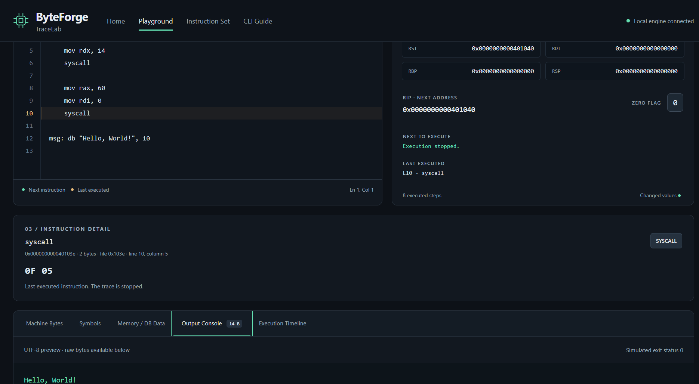

*Figure 8. Simulated Hello World after eight instructions: 14 output bytes and exit status 0. This browser view is separate from native execution.*

### A backward conditional branch

```asm
_start:
    mov rcx, 3

loop:
    sub rcx, 1
    cmp rcx, 0
    jne loop

    mov rax, 60
    mov rdi, 7
    syscall
```

RCX counts down to zero; JNE is taken twice and then falls through.
The arithmetic example computes `10 - 3`; the conditional example demonstrates
a non-taken JNE followed by a taken JE.

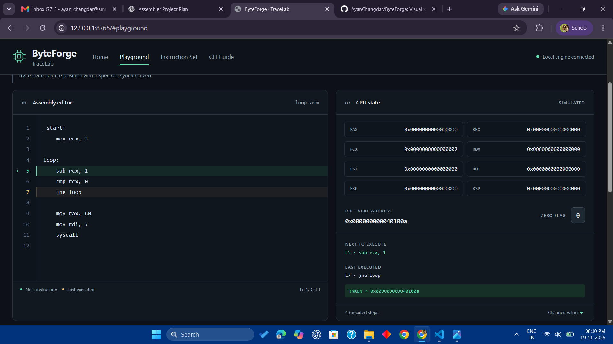

*Figure 3. After four executed instructions, RCX=2, ZF=0 and next RIP=0x40100A. JNE was taken; SUB executes next.*

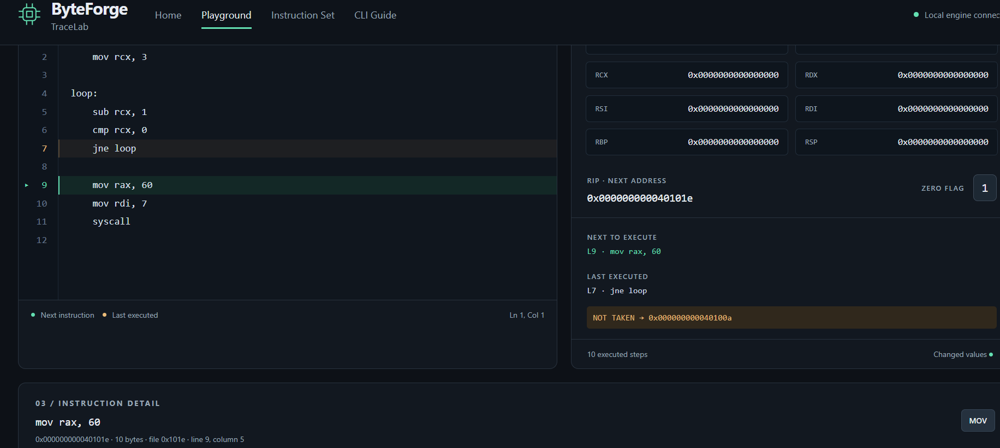

*Figure 4. After ten executed instructions, RCX=0, ZF=1 and next RIP=0x40101E. JNE was not taken; the exit setup is next and the process has not exited yet.*

## Architecture

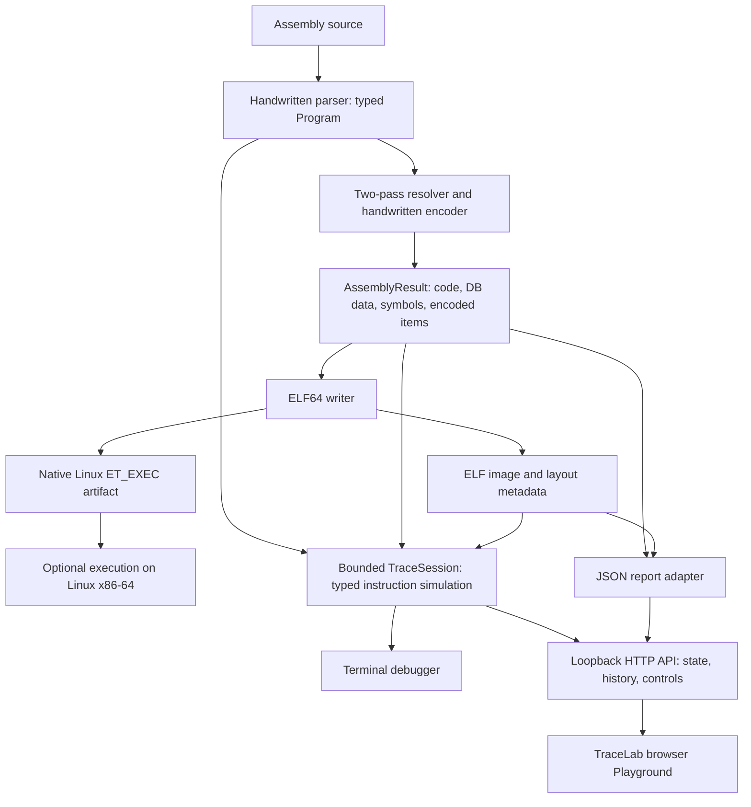

The parser preserves typed operands and source locations. Pass 1 establishes
fixed instruction sizes and symbol addresses; pass 2 emits the final bytes.
Instructions must precede data. The ELF writer wraps the resulting payloads.

The symbol table stores resolved virtual addresses, including forward data
references. In `hello.asm`, `_start=0x401000` and `msg=0x401040`; these are the
values displayed in the browser's **Symbols** tab.

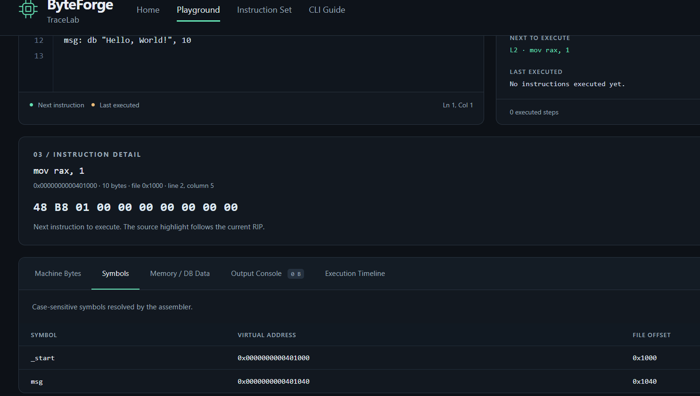

*Figure 6. Hello World's resolved symbols: _start=0x401000 and msg=0x401040, at file offsets 0x1000 and 0x1040.*

Tracing interprets the parsed instructions using the assembled addresses and
bytes as metadata. The browser renders API responses and sends controls to
the same Python engine used by the terminal debugger. JavaScript does not
reimplement assembly encoding or CPU execution.

## Handwritten x86-64 encoding

The encoder chooses opcodes, constructs prefixes and ModR/M bytes, checks
ranges, and packs little-endian values directly. Product code never invokes
NASM, GAS, GCC, `ld`, Keystone, or another external encoder.

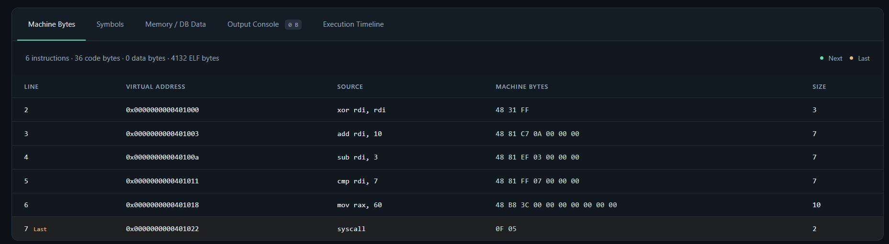

*Figure 5. arithmetic.asm has six instructions and 36 code bytes. Machine Bytes shows the actual encoding and size of each instruction.*

| Field | ByteForge's implementation |
|---|---|
| REX.W | `48`: 64-bit operand size for supported MOV/arithmetic/XOR forms |
| MOV opcode | `B8 + destination register code`; no ModR/M byte |
| Group 1 arithmetic | `81` with ModR/M extension `/0` ADD, `/5` SUB, `/7` CMP |
| XOR opcode | `31`; ModR/M reg is the source, r/m is the destination |
| imm64 | Eight little-endian bytes; used by numeric and symbolic MOV |
| imm32 | Four signed little-endian bytes; sign-extended by the CPU |
| rel32 | Four signed little-endian bytes relative to the following instruction |

Base register codes are `RAX=0, RCX=1, RDX=2, RBX=3, RSP=4, RBP=5, RSI=6, RDI=7`.
Register-direct ModR/M is `0xC0 | (reg_or_extension << 3) | destination_code`.

Numeric MOV accepts `-2^63..2^64-1`; negative values use their 64-bit
two's-complement representation. Arithmetic accepts exactly
`-2147483648..2147483647`, with no automatic imm8 optimization.

Branches use fixed near forms: `E9 rel32`, `0F 84 rel32`, and `0F 85 rel32`.
Their displacement is:

```text
rel32 = target virtual address - (instruction virtual address + instruction size)
```

In the loop example, JNE at `0x401018` targets `0x40100A`:

```text
0x40100A - 0x40101E = -20
bytes: 0F 85 EC FF FF FF
```

The encoder's `encoded_size()` and `encode()` share form validation.
The resolver verifies emitted lengths against planned sizes. Short jumps and
branch relaxation are not implemented.

## ELF64 layout and addresses

ByteForge writes little-endian ELF64 with `struct`, using `ET_EXEC` and
`EM_X86_64`. It emits one `PT_LOAD` segment with read/execute permissions,
alignment `0x1000`, file offset 0, and virtual/physical base `0x400000`.

| File region | File offset | Virtual address | Size |
|---|---:|---:|---:|
| ELF64 header | `0x0000` | `0x400000` | 64 bytes |
| Program header | `0x0040` | `0x400040` | 56 bytes |
| Zero padding | `0x0078` | `0x400078` | 3,976 bytes |
| Machine code | `0x1000` | `0x401000` | Encoded code length |
| DB data | Immediately after code | Immediately after code in memory | DB byte length |

For the single segment:

```text
virtual address = 0x400000 + file offset
data address    = 0x401000 + total code size + offset within DB data
file size       = 0x1000 + code size + data size
p_filesz        = p_memsz = complete file size
```

The ELF entry is the resolved, case-sensitive `_start` label. It must identify
an actual instruction boundary, including when other instructions precede it.
It is not hardcoded to the first instruction.

There is no section-header table, interpreter, dynamic linker, relocation
table, PIE, or BSS region. Code and DB data share the one RX segment; DB memory
is not writable. The ELF regions above are not separate ELF sections.

For Hello World, code is 64 bytes and data is 14 bytes:
`msg` is at file offset `0x1040` / virtual address `0x401040`, and the complete
ELF is 4,174 bytes.

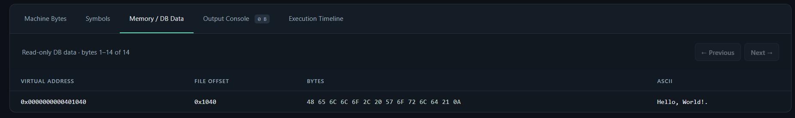

*Figure 7. All 14 Hello World DB bytes, starting at virtual address 0x401040 / file offset 0x1040. The final 0A is a newline, shown as a dot in the ASCII column.*

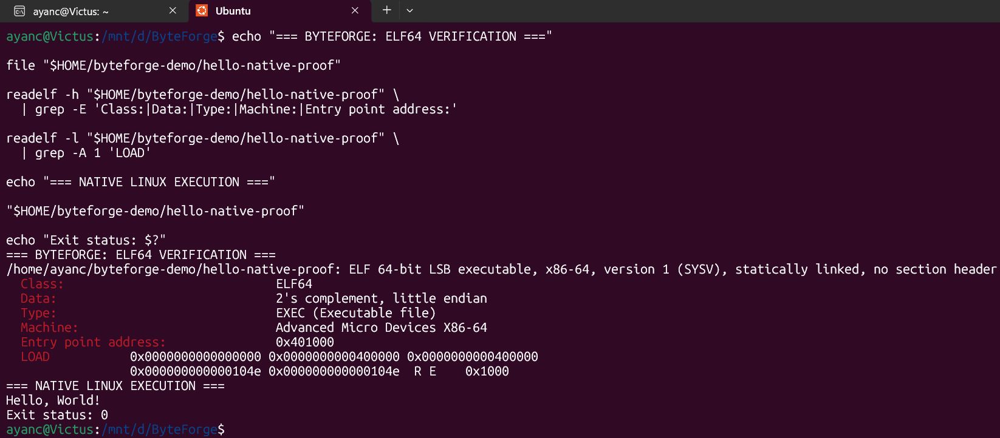

*Figure 9. Captured Ubuntu/WSL verification with file and readelf: ELF64, little-endian, x86-64 ET_EXEC, entry 0x401000 and one RX LOAD segment. Native execution prints Hello, World! and returns status 0.*

## Supported assembly language

| Instruction/directive | Accepted operands | Size |
|---|---|---:|
| MOV | Base `r64, integer` | 10 bytes |
| MOV | Base `r64, symbol` | 10 bytes |
| ADD | Base `r64, signed imm32` | 7 bytes |
| SUB | Base `r64, signed imm32` | 7 bytes |
| CMP | Base `r64, signed imm32` | 7 bytes |
| XOR | Base `r64, r64` | 3 bytes |
| JMP | Code label | 5 bytes |
| JE | Code label; branch when ZF=1 | 6 bytes |
| JNE | Code label; branch when ZF=0 | 6 bytes |
| SYSCALL | No operands | 2 bytes |
| DB | ASCII strings and integers in `0..255`, after instructions | Data length |

Only `RAX, RBX, RCX, RDX, RSI, RDI, RBP, RSP` are supported, all at 64-bit width.

- Mnemonics/registers are case-insensitive; labels preserve spelling and case.
- Labels start with an ASCII letter or underscore, followed by ASCII letters,
  digits, or underscores. Only one label is allowed per source line.
- Blank lines, whitespace, semicolon comments, signed decimal and hexadecimal
  integers, and labels preceding an instruction/directive on the same line work.
- DB strings use double quotes and support `\\`, `\"`, `\n`, `\r`, `\t`,
  and `\0`. Data has no implicit NUL terminator; `db ""` represents empty data.
- Duplicate/undefined labels and invalid operand forms produce diagnostics.
- Branches must target instruction boundaries, not data or end-of-code labels.
  Symbolic MOV may reference code or data addresses.
- No instruction may follow the first DB directive, even an empty one.

Unsupported forms include register-to-register MOV, register-register
ADD/SUB/CMP, XOR immediates, memory operands, R8-R15, narrower registers,
indirect branches, expressions, macros, user-defined sections and other
instruction mnemonics. String lengths and syscall byte counts are literal;
expressions such as `message_end - message` are not evaluated.

## Browser and terminal tracing

TraceLab starts all eight registers at zero, RIP at the resolved entry,
ZF=false, with empty output and no exit status. These are deterministic
educational values, not the register state supplied by Linux at process entry.

Arithmetic wraps at 64 bits. MOV and branches preserve ZF; ADD, SUB, CMP and
XOR update the modeled ZF. CMP does not modify its operands. Other CPU flags,
a stack, writable memory and general x86 execution are not modeled.

Two Linux syscall behaviors are modeled:

| Number | Modeled behavior |
|---:|---|
| 1: write | Only fd 1; complete reads from mapped DB data; exact output capture; RAX becomes byte count |
| 60: exit | Record `RDI & 0xFF` and halt without executing another instruction |

Successful modeled syscalls set RCX to the following instruction address and
preserve ZF as an educational simplification. R11 and full RFLAGS are not
modeled. Zero-length writes succeed without reading memory; unsupported syscall
numbers/descriptors, invalid ranges and exhausted limits stop explicitly.
There is no model of partial writes, signals, errno or a full Linux kernel.

### Browser workflow

Home links to Playground, the supported Instruction Set overview and CLI Guide.
The Playground provides a textarea editor with line numbers, source diagnostics,
eight registers, RIP/ZF, next/last instruction markers and changed-value highlights.

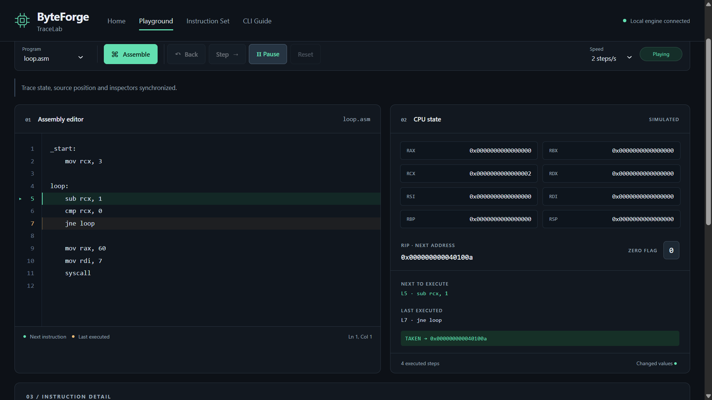

*Figure 2. The assembled loop during playback: editor, execution controls and simulated CPU panel. This capture shows four completed steps, RCX=2 and ZF=0.*

Its tabs show **Machine Bytes**, **Symbols**, **Memory / DB Data**,
**Output Console** and **Execution Timeline**. Instruction details display
actual source, address, file offset, byte length and encoded bytes.

- Assemble validates source and prepares a trace; it does not execute native code.
- Step executes one simulated instruction; Play schedules sequential steps.
- Pause stops future scheduling; an in-flight request may still finish.
- Back restores saved registers, flags, RIP, output and halt/exit state.
- Reset clears history/output and restores the initial state.
- Editing source or changing examples invalidates displayed results and disables
  execution until reassembly. Stale sessions also require reassembly.
- Register/address values remain exact hexadecimal strings in JSON; raw output
  bytes are preserved alongside a UTF-8 or escaped preview.

Shortcuts: Ctrl+Enter Assemble, F10 Step, Shift+F10 Back, F9 Play/Pause.
Inspector tabs support arrow keys, Home and End. The layout stacks on narrow screens.

### Terminal commands

| Command | Action |
|---|---|
| `next` / `n` | Advance or replay one cached transition |
| `back` | Restore the previous saved state |
| `registers` | Display all eight registers, RIP and ZF |
| `memory ADDRESS [LENGTH]` | Inspect read-only DB bytes; default length 16 |
| `continue` / `c [STEPS]` | Advance a bounded number of steps; default 100 |
| `reset` | Clear history/output and restart |
| `help` | Show available commands |
| `quit` / `q` | Leave the debugger |

Memory addresses/lengths accept decimal or `0x` notation. Quit/EOF returns
debugger process status 0 independently of simulated exit status; Ctrl+C returns
130. Source/file errors return 1 and argument errors return 2. The assembler
CLI likewise returns 0 for success, 1 for build/file errors and 2 for arguments.

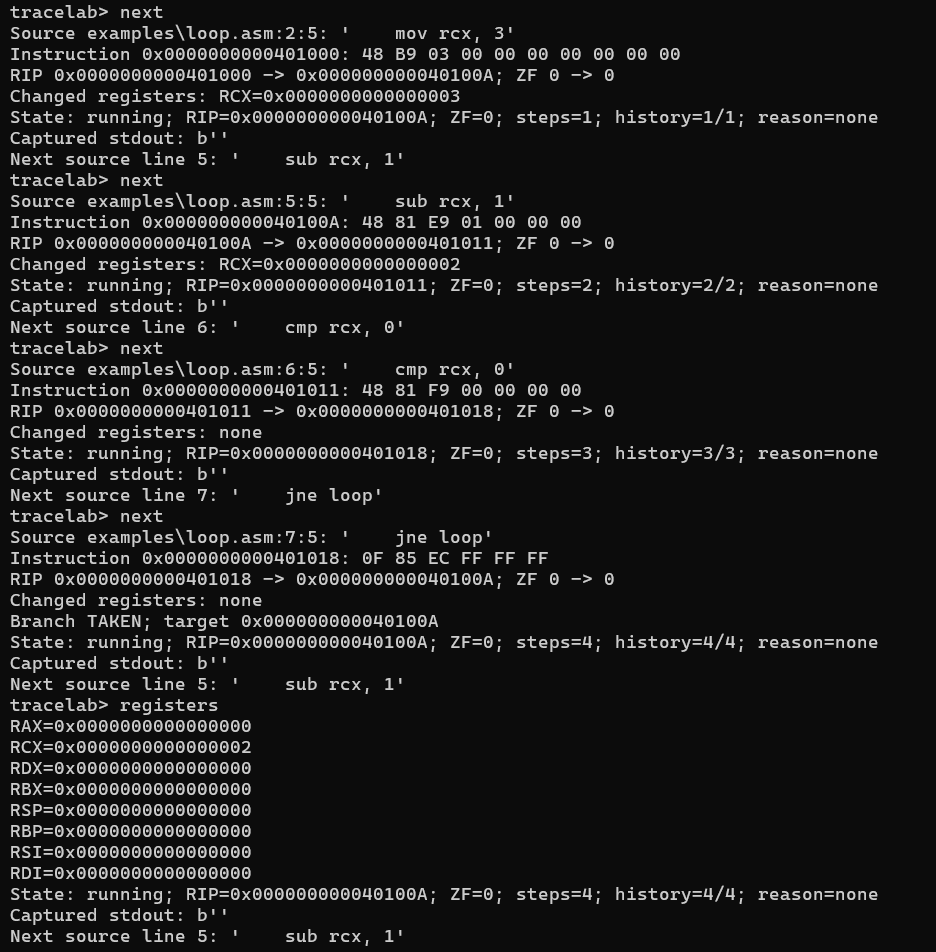

*Figure 10. The shared terminal trace engine after four next commands: JNE is taken to 0x40100A, RCX=2 and ZF=0. The registers command displays the simulated state.*

## Local API and security

The HTTP server is for local educational use. It is **not production-ready**
and does not provide a public deployment, HTTPS/TLS or multiple independent
user workspaces. All tabs share one active workspace.

- Binds exclusively to `127.0.0.1`, validates Host, and checks Origin when supplied.
- Requires a per-process mutation token on POST requests and current session
  ID/revision preconditions; stale requests return HTTP 409.
- Serializes state changes, validates JSON and enforces bounded inputs.
- Serves only the fixed visualizer assets and five allowlisted example sources.
- Never opens user-supplied paths, writes files, launches a shell/subprocess or
  executes generated ELF in response to an HTTP request.
- Uses no permissive CORS, disables access logging by default, renders user
  content as text and sets no-store, nosniff, framing and CSP headers.

| Resource | Default / hard maximum |
|---|---:|
| UTF-8 trace source | 65,536 bytes |
| Assembled trace instructions | 2,048 |
| Executed trace steps | 10,000 |
| Saved transitions | 10,000, plus one terminal non-executed limit result |
| Captured stdout | 65,536 bytes |
| Continue request | 100 steps |
| Memory inspection | 256 bytes |
| Timeline page | 100 events |
| HTTP body / header block / request line | 512 KiB / 16 KiB / 2,048 bytes |
| HTTP connection deadline | 3 seconds by default; constructor permits up to 10 seconds |

Trace limits may be lowered, not raised above their hard maxima. These are
trace/API limits, not a claim that the standalone assembler CLI bounds source
file reads. Connection deadlines can close stalled clients; they do not
hard-preempt Python CPU work or undo already accepted mutations. The token
does not authenticate the application against other local processes.

The API exposes GET bootstrap/examples/state/timeline/memory/ELF and POST
assemble/trace. ELF download is optional; it never executes the artifact.
See [TraceLab contracts](docs/TRACELAB.md) for exact routes, schemas and errors.

## Testing and validation

Run from the repository root:

```bash
python -m unittest discover -s tests
```

Focused checks:

```bash
python -m unittest discover -s tests -p test_encoder.py
python -m unittest discover -s tests -p test_elf.py
python -m unittest discover -s tests -p test_report.py
python -m unittest discover -s tests -p test_trace.py
python -m unittest discover -s tests -p test_trace_server.py
```

Tests cover golden instruction bytes, immediate ranges, forward/backward
branches, parser diagnostics, two-pass symbols, ELF fields/layout, binary
regressions, trace semantics/history, CLI behavior, serialization and real
temporary loopback HTTP servers. Native tests execute only the five fixed
example fixtures with subprocess timeouts on Linux x86-64; they skip elsewhere.

Verification snapshot, **2026-11-19**: the full Windows suite ran 367 tests:
362 passed, 0 failed and 5 native-execution tests skipped. The five native tests
were then run separately in Ubuntu/WSL: 5 passed, 0 failed and 0 skipped.
All five example ELF images matched their regression hashes and existing build
artifacts byte for byte. Test totals can change; rerun the suite for the current result.

To repeat the native fixture tests from the repository root in Linux/WSL:

```bash
python3 -B -m unittest discover -s tests -p test_integration.py -k native_linux -v
```

For browser interaction checks, use the
[manual acceptance checklist](docs/TRACELAB.md#browser-acceptance-checklist).

Optional Linux inspection tools are not ByteForge dependencies:

```bash
file build/hello
readelf -h -l build/hello
```

The ELF has no section table, so ordinary `objdump -d` may show no code.

## Troubleshooting

| Symptom | What to check |
|---|---|
| `No module named byteforge` | Run from the repository root with Python 3.10+. The module is used directly from the checkout; a package install is not required. |
| `python` is unavailable or selects the wrong version | Check `python --version`; use `python3` on Linux/WSL or `py -3` on Windows where available. WSL uses its own Python installation. |
| `Refusing to overwrite existing output` | Choose a new destination, for example `python -m byteforge.cli examples/hello.asm -o build/hello-new`. Existing files are deliberately preserved. |
| The server cannot bind port 8765 | Stop your previous ByteForge server with Ctrl+C, or run `python -m byteforge.trace_server --port 8766` and open `http://127.0.0.1:8766`. |
| HTTP 403 or the Playground cannot connect | Use the printed `http://127.0.0.1:PORT` URL. Do not substitute `localhost`, a different port, or a `file://` URL for `visualizer/index.html`. Keep the Python server running. |
| HTTP 409 or a stale-workspace message | Another tab or request changed the shared workspace. Pause, review the editor source and reassemble before continuing. |
| Assembly fails with a caret diagnostic | Read the filename, 1-based line/column and original source line. Check the operand matrix, immediate ranges, required `_start`, label spelling and instruction-before-DB rule. |
| `Permission denied` when executing an ELF | Run from Linux/WSL, check executable permission and try a fresh output in the Linux home filesystem as described above. Windows-mounted permissions may differ. |
| `Exec format error` or Windows cannot open the executable | Confirm Linux x86-64. The output is ELF64, not a Windows executable or an ARM-native program. |
| Play stops at a fault or limit | Inspect the halt reason and timeline. Unsupported syscalls/descriptors, unmapped DB reads and resource limits stop explicitly; no successful exit is invented. |

For a syntax diagnostic, correct the source and rerun the same assembly
command. The assembler CLI returns 1 on source/build errors and does not
create an output file for an assembly diagnostic. Browser diagnostics point
back to the editor; editing invalidates the old trace until reassembly.

For deeper behavior and interface details, see the
[TraceLab contracts](docs/TRACELAB.md) and
[architecture notes](docs/ARCHITECTURE.md). Historical planning in the latter
does not expand the implemented instruction subset.

## Repository layout

```text
byteforge/
  parser.py        Source scanning and typed statements
  model.py         Source locations, diagnostics, assembler/ELF contracts
  encoder.py       Handwritten fixed-size x86-64 encoding
  resolver.py      Two-pass layout and symbol resolution
  elf.py           In-memory ELF64 construction
  report.py        JSON adapters over assembly and trace metadata
  cli.py           Assembler arguments and file I/O
  trace_model.py   Trace state, limits and snapshot contracts
  trace.py         Pure preparation, stepping and reversible sessions
  trace_cli.py     Interactive terminal debugger
  trace_server.py  Loopback API and allowlisted static assets
visualizer/
  index.html       Home, Playground, Instruction Set and CLI Guide
  styles.css       Responsive dark interface
  app.js           API/workspace controls and stale-response handling
  panels.js        Safe rendering of metadata and simulated state
examples/          Five assembly demonstration programs
tests/             Standard-library unittest suite
docs/              Architecture, TraceLab contracts and historical team plan
  ss/              Ten genuine application and terminal screenshots, with capture guide
LICENSE            MIT license
```

Generated executables normally go into the ignored `build/` directory.

## Release, deployment and screenshots

This README describes the implementation currently present in the checkout:
the assembler, terminal debugger, local API and Stage 6B.2 browser Playground.
Detailed opcode-field explanations, a richer instruction reference and the
advanced ELF viewer are planned Stage 6C work, not current features.

No version tag or public hosted deployment was verified in this checkout.
The supported launch target is the local Python server, not a hosted HTTPS
Playground. The verified GitHub repository is currently private; access requires
authorization as noted in Quick Start.

Ten genuine, manually captured PNGs are included under `docs/ss/` and linked
beside the workflows they illustrate. The [screenshot index](docs/ss/README.md)
describes each capture. Browser and debugger images show simulated execution;
the Ubuntu/WSL terminal image separately records native ELF inspection and
execution. No images were generated or retouched for this documentation.

## Contributing and reporting issues

Keep changes focused and explainable. Read [AGENTS.md](AGENTS.md) and the
[TraceLab contracts](docs/TRACELAB.md) before changing interfaces. Run focused
tests for the affected component, then the complete `unittest` suite. Encoding
changes need golden bytes and size checks; branch changes need forward/backward
cases; layout changes need ELF field, offset and entry-point checks. Document
any supported-form changes and preserve existing binary regressions.

For a bug report, include:

- OS, architecture, Python version and browser/version where relevant.
- The exact command or browser interaction that reproduces the issue.
- A minimal assembly example, expected behavior and actual result.
- The complete diagnostic or halt reason, plus relevant test output.
- Whether the result came from simulated tracing or native Linux execution;
  report native-test skips separately from passing execution tests.

Use the verified [repository](https://github.com/AyanChangdar/ByteForge)'s
Issues or pull-request interface if your access provides it. Otherwise, share
the report with the maintainer through your existing project channel.
Exclude private source, credentials and mutation tokens from
public reports. Propose changes to the instruction subset or architecture
before undertaking a broad implementation.

## References and attribution

- [TraceLab documentation](docs/TRACELAB.md): implemented state, API and UI contracts.
- [Architecture notes](docs/ARCHITECTURE.md): design rationale, encoding choices
  and historical milestone plans; some planning sections describe deferred work.
- [Historical team plan](docs/TEAM_TASKS.md): original project schedule and ownership.
- [AmmAsm](https://github.com/LinuxCoder13/AmmAsm) and
  [x86Lab](https://github.com/JBouron/x86Lab): conceptual references credited in
  the architecture notes. Their public repository metadata was verified for
  this README; this review does not claim a fresh audit of their source code.

ByteForge's author and copyright holder is **Ayan Changdar**, as recorded in
the repository license.

## License

[MIT License](LICENSE). Copyright (c) 2026 Ayan Changdar.

See the license file for the complete permission, attribution and warranty terms.
